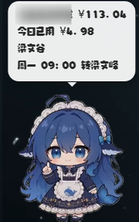

# Reasonix_dsh-pet

把 [dsh-pet](https://github.com/PC2005-cloud/dsh-pet) 桌宠适配到 Reasonix Studio 的插件。

> 版本：`DSH_pet_reasonix 2.1.6`  
> 2.1.6：外观设置（桌宠大小 / 气泡大小 / 文字大小）；自动归位固定加速度、降低最高速，未到位不停止跑步动画。  
> 2.1.5：任务完成常驻提示；桌宠自动归位（窗口右下角/屏幕右下角，等待时间可调，可关闭）。  
> 2.1.4：补回 Electron Chromium 许可证，精简 vendor 体积，修复 `pet.cmd install`。  
> 2.1.3：修复手势收尾方法缺失导致的拖拽松手不抛掷、松开音效不响。  
> 固定源码：`https://github.com/BulkCooper/Reasonix_dsh-pet/tree/05159df0aa64681fb195f6004c2273be64ffaec5`  
> 上游：`dsh-pet@0.3.7`（MIT），Electron `43.3.0`

<p align="center">
  
  
</p>

## 功能

- 桌面透明置顶桌宠，支持拖拽、点击、右键菜单
- Reasonix 会话事件联动：思考 / 工作 / 整理 / 等待 / 完成 / 出错
- 本地余额面板：余额、今日已用、峰谷状态、余额预警
- 手动多账户：设置页最多新建 10 个账户，分别填写名称、余额接口和 key
- 按下 / 松开双音效：按下播完才播松开；latest-wins 连点不积压；拖拽松开也播放，不回落错误音效
- 可配置 OpenAI 兼容对话 API；右键「对话」「碎碎念」
- 设置页底部固定保存栏、清除今日已用
- 任务完成常驻提示：Stop 时显示，点击桌宠、切回 Reasonix 窗口或新任务开始时消失
- 自动归位：Reasonix 窗口开启时走向其右下角，窗口关闭/最小化时回主屏右下角；拖拽后按设置等待（默认 60 秒，0–3600 可调），可在设置页关闭；0.8 秒起跑段 + 固定加速度、较低巡航速度，未到位时跑步动画持续，左右方向镜像
- 设置页「桌宠行为」：自动归位开关 / 拖拽后等待秒数
- 外观设置：桌宠大小 160–640 px；文字弹窗大小（0.6–2×）与文字大小（10–30 px）可独立调整

## 合规说明（审核整改）

- **生命周期**：只由 Reasonix hooks 控制；并注入 Reasonix 主进程 PID，应用退出后桌宠/面板自退出（不是常驻 supervisor）。
  - `SessionStart`：启动桌宠和本地面板服务
  - `SessionEnd`：停止桌宠和本地面板服务
  - 若恢复旧会话没有触发 SessionStart，第一个 prompt/tool 事件会补启动
  - 没有 Startup 文件夹条目、没有常驻 supervisor、没有独立 watchdog。
- **运行时固定附带**：`vendor/*.zip` 内置 `dsh-pet@0.3.7` 与 Electron `43.3.0`。
  - 安装和首次启动都不访问 npm / Electron 镜像，不下载代码。
  - `scripts/install.mjs` 只在本地解压；解压后 `runtime/` 与 `home/electron/` 即固定版本。
- **不修改安装后的第三方文件**：余额气泡、菜单调整和音效代码已经包含在 `vendor/pet-runtime.zip` 的适配构建中；仓库不再运行 `patch-*.mjs`。
- **不读取其他组件凭证**：
  - **窗口检测**：只读取 Reasonix 主窗口矩形、可见性与前台 PID；不读取窗口内容，也不读取任何凭证。
  - 不读取 Reasonix 的 `.env`、`config.toml`、stats 或其他用户文件。
  - 余额/对话 API key 只读取插件自己的 `home/balance-config.json`，由用户在设置页填写。
  - key 不写入日志，也不通过 `/status` 返回。
- **网络**：
  - 本地：`127.0.0.1:34740`（桌宠）、`127.0.0.1:34741`（余额/对话面板）
  - 余额：`https://api.deepseek.com/user/balance`
  - 对话：用户在设置里填写的 `chatBaseUrl`（默认 `https://api.deepseek.com/v1`）
- **进程**：
  - 一个 `node` 进程运行 `runtime/node_modules/dsh-pet/lib/standalone.js`
  - 一个 `node` 进程运行 `scripts/balance.mjs`
  - 一个 Electron 子进程显示桌面窗口
  - 这些进程都随 hooks 启停，不常驻。

## 安装

1. 确认 `vendor/pet-runtime.zip`、`vendor/electron-1.zip`、`vendor/electron-2.zip` 完整。
2. 运行：

```bat
pet.cmd install
```

安装脚本只做本地解压和校验，不联网。

3. 右键桌宠 → 设置，填写自己的 DeepSeek API key；需要对话时填写对话 API key（可留空复用余额 key）。

## 生命周期

- 打开 Reasonix 会话：`SessionStart` 启动桌宠
- 结束会话：`SessionEnd` 停止桌宠和面板
- 不安装启动项；Reasonix 未打开时不会运行桌宠。
- 强制结束 Reasonix 进程属于异常路径，hook 不会触发；下次正常启动时会重新拉起。

## 目录

```
reasonix-plugin.json
pet.cmd / pet-hook.cmd
scripts/config.mjs / control.mjs / pet-hook.mjs / pet.mjs / install.mjs
scripts/balance.mjs / settings-page.mjs
vendor/pet-runtime.zip
vendor/electron-1.zip / electron-2.zip
vendor/manifest.json
home/dsh-pet/main-config.jsonc
skills/pet/SKILL.md
commands/pet.md
```

## 账户说明

为满足审核要求，插件不再自动读取 Reasonix 的 providers。余额面板使用**用户手动添加的账户**（最多 10 个，名称 + key + 余额接口），不读取 `.env` 或 `config.toml`。每轮消耗统计已移除。

## 体积与裁剪

`vendor/` 约 177 MB（Electron 约 116 MB + 桌面运行时约 61 MB）。为减小安装与更新体积：

- 删除 Electron 的 `dxcompiler.dll` / `dxil.dll`：桌宠不使用 WebGPU / DirectX Shader Compiler，实测不影响启动与动画；
- 删除桌面模式不需要的客户端 / 开发依赖：React、react-dom、zod、`@deepseek-ai/*`、eslint 相关、ajv、js-yaml、yaml，以及 `dsh-pet` 的 `src` / `lib/types` / `scripts`；
- `@electron-internal/extract-zip` 只保留 win32-x64 原生模块；
- 保留 `@electron/get` 与 `extract-zip`（`standalone.js` 顶层 import 与动态 fallback 仍会加载）；
- 保留 Electron 的 `LICENSES.chromium.html`（约 19.4 MB，压缩后约 2.1 MB）和 `LICENSE`；
- `electron.exe`（压缩后约 92.5 MB）与 webm 动画素材（约 51.8 MB）是体积主体，不再裁剪。

## 来源与许可

- `dsh-pet@0.3.7`：MIT，原作者 PC2005-cloud
- 自适应修改：BulkCooper
- Electron `43.3.0`：`LICENSE` 与 `LICENSES.chromium.html`（Chromium 第三方许可证）均包含在 `vendor/electron-2.zip`
- 点击音效 D1/D2/Ya1/Ya2：来自 DeepSeek-Balance-Whale-Widget（MIT）
